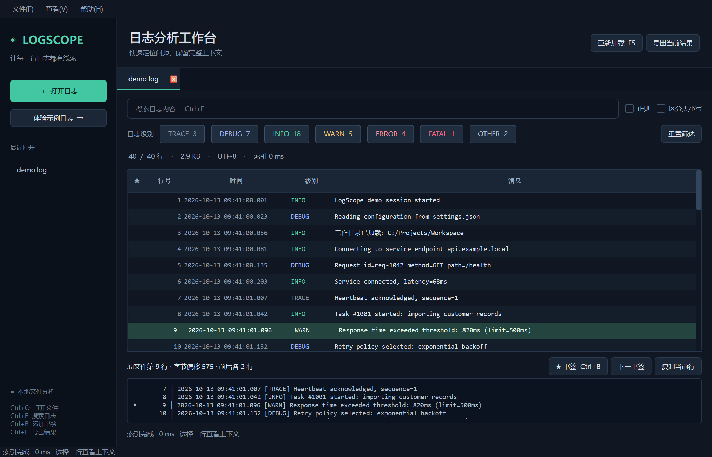

# LogScope

面向开发者的 Qt / C++ Windows 日志分析工作台。通过行偏移索引和按需读取浏览日志，在后台完成搜索和导出。



## 已实现

- 打开、拖拽导入 UTF-8 日志，多标签浏览；最近文件记录。
- 时间 / 级别 / 消息分列显示，支持常见 ISO 时间戳与 TRACE、DEBUG、INFO、WARN、ERROR、FATAL 日志头。
- 关键词与正则搜索、大小写选项、级别组合过滤；输入防抖、进度与任务取消。
- 选择筛选结果后查看原文件中前后各两行的上下文。
- 添加、移除和跳转书签；书签按文件版本持久保存。
- 后台导出当前结果，保留完整行；通过 QSaveFile 提交文件，取消或出错时保留原目标文件。
- 文件变化检测，旧索引立即失效；可选择变化后自动完整重载。
- MSVC + CMake 构建、Qt Test 自动测试、独立性能测量工具。

## 构建与运行

环境要求：Windows 10/11、Visual Studio 2022 的「使用 C++ 的桌面开发」工作负载、Qt 6.5+ MSVC x64 SDK，包含 Qt Test。已在本机 Qt 6.7.3 MSVC2019 x64 + MSVC 2022 上验证。

在项目根目录执行 PowerShell：

```powershell
# 配置、编译、运行测试，并收集可运行的 Qt 依赖
.\scripts\build.ps1 -Package

# 自己的 Qt 安装路径
.\scripts\build.ps1 -QtRoot 'D:\Qt\6.8.3\msvc2022_64' -Package

# 启动发布包；示例也可以在界面中打开
.\dist\LogScope\LogScope.exe --demo
```

也可直接在 Visual Studio 或 Qt Creator 中打开根目录的 `CMakeLists.txt`，选择 MSVC x64 的 Qt Kit。首次切换生成器或 SDK 时，请使用新的构建目录。

手动构建示例：

```powershell
$cmake = 'C:\Qt\Tools\CMake_64\bin\cmake.exe'
& $cmake -S . -B build -G 'Visual Studio 17 2022' -A x64 '-DCMAKE_PREFIX_PATH=C:\Qt\6.7.3\msvc2019_64'
& $cmake --build build --config Release --parallel
$env:PATH = 'C:\Qt\6.7.3\msvc2019_64\bin;' + $env:PATH
& 'C:\Qt\Tools\CMake_64\bin\ctest.exe' --test-dir build -C Release --output-on-failure
.\build\Release\LogScope.exe --demo
```

快捷键：`Ctrl+O` 打开、`Ctrl+F` 搜索、`Ctrl+B` 书签、`Ctrl+E` 导出、`Ctrl+W` 关闭标签、`F5` 重载。

## 可复现性能测量

`LogScopeBench` 按确定的规则生成数据，随后测量索引和搜索。每 100 行包含一个 timeout 匹配，结果应为行数的 1%。输出 JSON 包含文件大小、耗时、匹配数、索引容量及 Windows 进程峰值工作集。

```powershell
$env:PATH = 'C:\Qt\6.7.3\msvc2019_64\bin;' + $env:PATH
# 约 17 MB
.\build\Release\LogScopeBench.exe --generate benchmark-data\small.log --lines 100000
# 大文件测试：实际大小以输出 JSON 为准，生成文件会占用相应磁盘空间
.\build\Release\LogScopeBench.exe --generate benchmark-data\large.log --lines 6500000
# 测量已有文件
.\build\Release\LogScopeBench.exe samples\demo.log --query timeout
```

实测记录见 [docs/benchmark.md](docs/benchmark.md)。命令行测量的是核心索引与搜索耗时，不能作为 GUI 首屏耗时或 UI 响应延迟的证据。

## 验证记录

18 项 Qt Test 检查通过，包含跨块换行、中文路径与文本、UTF-8 BOM、正则错误、文件变化、源文件导出保护、关闭运行中任务以及过期搜索结果隔离。Windows 原生平台与 offscreen 平台均运行通过。

发布程序通过 Windows 平台启动与截图检查；该检查的 PATH 只包含 Windows 系统目录，未使用 Qt SDK 的 bin。发布目录已包含 Qt 插件和 MSVC Release CRT DLL。此验证在本机完成，尚未在全新 Windows 虚拟机上验证。

## 结构

```text
src/core/logindex.*   字节偏移索引、级别解析、搜索、原子导出
src/core/jobs.*       QThread 任务、取消标志与节流进度
src/ui/logmodel.*     按需读取表格模型、4 MB 文本缓存、书签映射
src/ui/logtab.*       单文档状态、筛选、上下文、文件监测
src/ui/mainwindow.*   多标签、拖拽、最近文件、菜单
tests/               核心与界面集成测试
tools/benchmark.cpp  可复现数据生成与性能测量
scripts/build.ps1    构建、测试、发布包
```

具体设计与取舍见 [docs/architecture.md](docs/architecture.md)。项目展示建议见 [docs/resume.md](docs/resume.md)。

## 当前边界

- 支持 UTF-8（含 BOM）和 LF / CRLF；UTF-16/32 会给出转换提示。其他编码没有自动识别。
- 索引仍与行数成正比，并非恒定内存。当前 `LineEntry` 在 x64 上占 24 字节，容器预留容量另有开销。
- 单行限制 8 MB，以控制搜索内存。表格预览前 2 KB，上下文和复制每行最多 64 KB；导出保留完整行。
- 自动重载使用 750 ms 防抖后重建完整索引；持续写入的大文件可能无法得到稳定快照。增量追加索引尚未实现。
- 搜索在每行之间检查取消；正在执行的单次正则匹配和操作系统 I/O 不会被强制中断。
- 文件一致性使用大小、修改时间及文件监测校验，不是内容哈希校验。
- 同一文档同时只保留一个当前操作；开始搜索、导出或重载会取消旧任务。任务完成后在 GUI 线程提交结果。
- 尚未实现 SQLite 历史库、可配置日志格式、会话恢复和安装程序。
