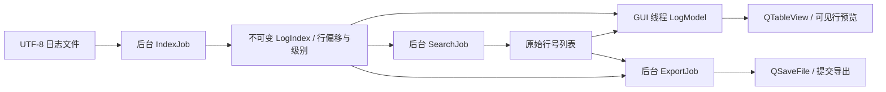

# 设计与取舍

## 数据流

索引扫描使用 1 MB 字节块，仅保留每行前 1 KB 来解析级别。每条索引包含原文件字节偏移、行字节长度、级别；没有保存整行文本。CRLF 的 CR 在读取内容时移除，偏移始终对应原文件的字节位置。块边界和 UTF-8 多字节字符不会改变字节索引。

`LogModel` 通过原始行号映射展示筛选结果。在全部可见时使用恒等映射，避免额外分配整份行号列表。表格只缓存短文本，缓存预算 4 MB。选中后从原文件读取上下文，因此搜索过滤掉的邻居仍可查看。

## 线程与生命周期

核心函数不依赖 Widgets，可直接测试和测量。Job 子类只在 `run()` 中执行核心函数，通过排队信号提交结果；不直接访问模型或控件。

每次新操作增加文档的 generation token。旧任务即使已经把结果发送到事件队列，也不能覆盖新任务的状态。取消标志使用原子布尔值。关闭文档先取消任务，再等待线程结束，保证线程引用的数据在运行结束前仍然有效。关闭延迟受单次文件读取和正则匹配耗时影响。

多个文档可以分别运行后台任务；同一文档的新操作会取消旧操作。搜索输入有 300 ms 防抖，进度信号最多约每 60 ms 发送一次，减轻 GUI 事件队列负担。

## 一致性与导出

索引开始记录文件大小和修改时间，结束再检查。搜索、导出前后也校验快照。文件变化事件使模型立即失效；监测父目录以发现文件替换后重新出现的情况。

导出拒绝覆盖源文件，采用 `QSaveFile` 写入临时文件，只有全部成功且快照有效时提交。空筛选结果可以导出为空文件。导出统一使用 UTF-8、LF，不写 BOM。

## 内存与性能

索引内存 O(N)，N 为行数；搜索结果额外需要 O(K) 个 32 位行号，K 为匹配数。读取块、单行解码和预览缓存受上限约束。很多短行的文件可能比少量长行的文件占用更多索引内存。

当前搜索按行读取并匹配，容易保持正确的上下文与级别过滤，但每行 seek/read 可能成为瓶颈。下一步可以比较「连续块扫描 + 行边界复用」与当前实现的性能，不应直接假设内存映射一定更快。

## 后续适合自行实现的迭代

1. 增量追加索引：区分追加、截断、替换；处理未完成的最后一行。
2. 结构化格式：自定义解析规则，支持 JSONL 字段列和堆栈归并。
3. Windows 文件身份校验：通过文件句柄身份强化替换检测。
4. 视图内命中高亮、书签列表、可恢复的工作会话。
5. 实测首屏时间、滚动响应和长时间追踪行为，区分冷缓存与热缓存。
